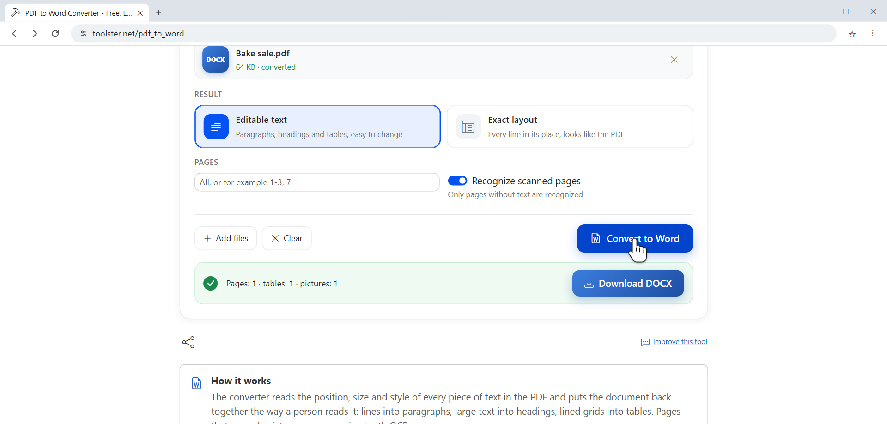

# PDF to Word Converter: free, editable DOCX, scanned pages recognized

**[Convert PDF to Word online](https://toolster.net/pdf_to_word)**. Free, no sign-up, the PDF stays on your device and is not uploaded.



Turn a PDF into a Word document you can actually edit. Paragraphs, headings, lists, tables and pictures come out in place, and scanned pages are recognized automatically.

## Features

- Rebuilds paragraphs, headings and bulleted lists
- Keeps two-column text in reading order
- Turns ruled tables into Word tables, merged cells included
- Recognizes text on scanned pages (English, Russian, Spanish)
- Exact layout mode keeps every line in its place
- Converts up to 20 PDF files at once into a ZIP
- Page range selection like `1-3, 7`
- Opens password protected PDFs if you know the password

## How to convert a PDF to Word

1. Open **[the converter](https://toolster.net/pdf_to_word)** and press **Choose PDF**.
2. Pick the result: **Editable text** for a normal document, **Exact layout** to keep the look of every page.
3. Type pages if you need only some of them, for example `1-3, 7`.
4. Press **Convert to Word** and download the DOCX.

## What people use it for

- Fixing a contract or an agreement that only came as a PDF
- Reusing text and tables from a report
- Updating an old form or a price list
- Getting text out of a scanned letter

## Helper scripts

Small Node.js scripts, no dependencies (Node 22+):

```bash
node scripts/pdf-check.js contract.pdf   # pages, password, real text or scanned pictures
node scripts/docx-stats.js contract.docx # paragraphs, words, headings, tables, pictures
npm test
```

`pdf-check.js` tells you before converting whether the file has real text or is a scan, so you know if the recognition step will be needed. `docx-stats.js` shows what ended up in the Word file, which makes it easy to compare the result with the original.

## More

- [About the PDF to Word converter](ABOUT.md): modes, tables, scans, fonts, privacy
- Other languages: [PDF в Word (RU)](https://ru.toolster.net/pdf_to_word), [PDF a Word (ES)](https://es.toolster.net/pdf_to_word)
- 240+ free browser tools: [toolster.net](https://toolster.net)

Found a bug or want a feature? [Open an issue](../../issues).

The converter itself is a hosted web app, its source code is not published here. The helper scripts are MIT licensed.
